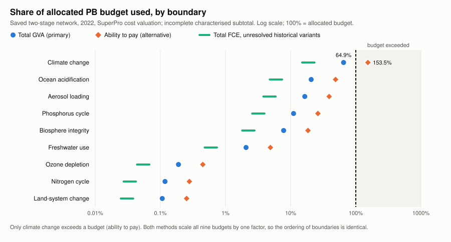

# Planetary-boundary allocation for the UK mAb network: final methodology

Consolidated 19 November 2026 on branch `feature/final-pb-allocation`. This document is the single reference for the two allocation methods used in the FYR: **total gross value added (GVA)**, the primary method (Hartmann et al. 2026), and **ability to pay (ATP)**, the alternative (Hjalsted et al. 2021). **Total final consumption expenditure (FCE)** is a supporting comparison only. The document merges Claude's implementation and audit with Astra's independent audit. Where the two disagreed, the source papers, code and raw data decided. The environmental impacts, the LCA and the joint MILP are unchanged.

| | |
|---|---|
| Code | [`pb_allocation.py`](pb_allocation.py): one entry point, committed data only |
| Results | [`results_allocation_final/`](results_allocation_final/) |
| Tests | [`tests/test_pb_allocation.py`](tests/test_pb_allocation.py): 42 tests pass; 24 export checks pass |
| Independent checks | [`tools/audit_from_raw.py`](tools/audit_from_raw.py) (Claude), [`audit/`](audit/) (Astra) |
| Traceability | §12 |

## 1. Final results

Saved two-stage network: 861 batches, 4,003.65 kg/yr of bulk drug substance, 2022 economy. The impacts are an **incomplete characterised subtotal**. Budgets are in native PBAESA units per year.

| Method | Role | Network share of global SOS | Climate budget (W/m²) | **Climate utilisation** | Exceeded boundaries | Verdict |
|---|---|---:|---:|---:|---|---|
| **Total GVA** (Hartmann Eq. 7) | **Primary** | 1.6684×10⁻⁶ | 1.6684×10⁻⁶ | **64.90%** | none | **Ready for MILP integration** (fixed exploratory budget) |
| **Ability to pay** × total GVA | **Alternative** | 7.0559×10⁻⁷ | 7.0559×10⁻⁷ | **153.46%** | climate | **Ready as a separate normative scenario**, interpreted as producer-region capacity |
| Total FCE (Oosterhoff equations) | Supporting | 3.6808×10⁻⁶ | 3.6808×10⁻⁶ | **29.42%** | none | Comparison only; not an MILP budget |

Both central values agree between the two reviews and are reproduced from raw sources to 3×10⁻¹⁵. The supporting total-FCE value changes from the earlier 15.0–23.2% range to **29.42%** (§6).

**Sensitivity ranges (climate)**

| | Total GVA | Ability to pay |
|---|---:|---:|
| One assumption at a time ([`sensitivity_climate.csv`](results_allocation_final/sensitivity_climate.csv)) | 51.5–93.3% | 106.1–1,539% |
| Value basis × input origin, 36 combinations ([`envelope_climate.csv`](results_allocation_final/envelope_climate.csv)) | 46.3–106.9% (6 of 36 exceed) | 84.2–1,763% (34 of 36 exceed) |
| Also × weight cases × 9 physical inventory cases ([`crossed_climate_sensitivity.csv`](results_allocation_final/crossed_climate_sensitivity.csv)) | **39.5–108.2%** (114 of 1,440 exceed) | **70.4–1,773%** (2,312 of 2,520 exceed) |
| Physical inventory cases only (materials × electricity), central budget | 55.5–65.3% | 131–154% |

These are discrete scenario ranges, not probability intervals. Over all cases, total GVA is within budget in 92% and ability to pay exceeds it in 92%. The most robust research finding is the one Astra stated: **the reference plan moves from below to above its climate threshold when entitlement changes from equal per-capita to income-weighted producer-region allocation**, before any design decision changes.

## 2. Reconciliation of the two reviews

| Topic | Claude | Astra | Resolution |
|---|---|---|---|
| PBAESA total-GVA error | Broadcasting bug; Eq. 7 factor 1.9729×10⁻⁴ | Same; replays workbook to 3×10⁻¹⁷ | **Agreed.** Correction kept. |
| Population weights sum to 1.000089 | Negligible | Normalising gives 64.9045% | Keep unnormalised (Hartmann replication); normalised case reported. |
| Central total GVA, ATP | 64.90%, 153.46% | 64.90%, 153.46% | **Agreed.** |
| "93% of ATP budget through 3.6% of inputs" | Claimed | Incorrect pairing | **Astra correct:** India + three RoW regions = 78.47% of budget from 2.70% of inputs; all foreign regions 92.58% from 25.55%. Corrected. |
| ATP income effect | Not stated | Budget per € ∝ 1/y² (income enters twice) | **Astra correct**; added to §5.4. |
| RoW country mapping | Hartmann Table 1 (World Bank regions) | EXIO3 concordance moves 14 countries; ATP 159.77% | Both confirmed. EXIO3 matches the EXIOBASE developers' `country_converter`; Table 1 is what Hartmann's weights use. Table 1 kept as reference for consistency with the primary method; EXIO3 reported (GVA 66.45%, ATP 159.77%). |
| PPP vs MER | PPP 149.7% vs 153.5% | Coverage differs; same 199 economies: MER 160.31%, PPP 149.70% | **Astra's matched comparison adopted.** |
| Hjalsted α residual (0.234 vs 0.243) | "Data revisions" | Population source and coverage also differ | Wording corrected to "approximate replication". |
| $92.10/g | "Lower bound", conservative | Zero-margin scenario; cost can exceed price; tolling and utilisation matter | **Astra's framing adopted**: zero-margin reference, not a bound. |
| No-inflation case | "Upper utilisation bound" | ONS C212 PPI fell (109.9 → 107.2), giving 74.33% | **Astra correct** (series verified). PPI cases added. |
| Operating-margin cases | "Upper bound" | Gross surplus includes depreciation already in SuperPro; not a bound | **Astra correct**: "illustrative uplift". |
| SuperPro filling | "Fill-finish has zero cost" | Detailed ledger: $49,282 labour + $145,200 consumables (bags, cartridges) | **Astra correct** (verified in the ICR). This is bulk filling (0.37% of cost), not drug-product fill-finish. |
| Total FCE | 15.0–23.2%, unresolved | 29.42% from the Oosterhoff equations; own sales counted twice | **Astra correct** (verified against the printed equations, §6). Implemented here as the supporting value; earlier variants are legacy. |
| Robustness | Corrected to combined envelopes | Extended with inventory, weights, PPI (crossed set) | Astra's crossed set adopted as the final ranges. |
| MILP use | Fixed budgets, scale rows, choose method outside the solver | Same; treat ATP as an ethical scenario | **Agreed.** |

## 3. Framework

Hartmann et al. (2026) build each factor with the two-step approach of Hjalsted et al. (2021). Step 1 shares the SOS between people by region. Step 2 shares each region's portion with the economic activity that creates value for those people. Step 3 (this project) downscales from the sector to the network. The two methods differ **only in step 1**.

```
F_j        = Σ_r w_r · a_rj · H_j / G_r                     Hartmann Eqs. 1, 4, 6–9
H_j        = m_j · V_j = x_j · g_j,   g_j = Σ_i v_i L_ij     type-I GVA multiplier m_j = g_j / v_j (Eq. 7)
a_rj       = (Σ_{i∈r} Z_ij + 1[r = home(j)] · V_j) / (Σ_i Z_ij + V_j)   first-tier origin shares (Eqs. 8–9)
s          = X / x_j                                         network share of sector gross output
B_c        = SOS_c · F_j · s,       utilisation_c = I_c / B_c
```

x_j is gross output, V_j direct GVA, v = V/x, L = (I − A)⁻¹, Z the transaction matrix, G_r regional direct GVA, and X the network's annual basic-price output (€ M₂₀₂₂). For GB Chemicals nec: x_j = 44,744.27, V_j = 16,233.04, g_j = 0.99999995 (so H_j = x_j), a_GB = 0.7445.

| Step 1 weight w_r | Definition |
|---|---|
| Total GVA (equal per capita) | Population share Pop_r/Pop_world (Hartmann Eq. 2; PBAESA 2022 values, GB 0.8525%) |
| Ability to pay | Σ_{c∈r} (P_c/P)(Y/P)/(D_c/P_c)·α = Σ_{c∈r} (P_c²/D_c)/Σ_k(P_k²/D_k), computed **per country** before summing to regions (Hjalsted Eq. 5, α from Eq. S1) |

Because step 1 and step 2 multiply into one scalar, every budget vector is SOS × one fraction. **Switching methods rescales all nine budgets equally:** ATP/GVA = 0.4229 for every indicator.

## 4. Total GVA (primary)

### 4.1 Sector and data
NACE 21.1 and 21.2 map to EXIOBASE product p24.d and industry i24.d, "Chemicals nec" (public concordances). This is the supported classification, but it is broad and a weak model of biotechnology. In the 2022 nowcast the UK sector also records zero compensation of employees and zero net surplus: its GVA is almost all consumption of fixed capital. Data: EXIOBASE 3.9.6, 2022 ixi, and the Hartmann allocation workbook (checksum matches Zenodo).

### 4.2 PBAESA error (verified by both reviews)
`np.divide(V, x)`, with V of shape (n,) and x of shape (n, 1), broadcasts to an n×n matrix V_k/x_i. `.iloc[:, 0]` then keeps the first sector's GVA in every numerator. The resulting multiplier, x_j Σ_i L_ij/x_i, contains no value-added coefficient, so it cannot be Eq. 7's type-I GVA multiplier (Keček et al.). This formula reproduces the published factor (4.1614×10⁻⁴) to 5×10⁻¹⁴ on our route and 3×10⁻¹⁷ on Astra's. Eq. 7 gives **1.9729×10⁻⁴**; the published value is 2.109× larger. We report the corrected value; author confirmation is pending.

### 4.3 Economic valuation: X
**Reference:** SuperPro full average production cost $92.09802/g (USD 2019), × 4,003.65 kg = $368.73 M. This is converted by USD→GBP (BoE 2019, 1.2766), the UK GDP deflator (ONS YBGB, 81.1 → 90.6) and GBP→EUR (ECB 2022, 0.85276), giving **€378.38 M**, a share s = 0.84566%.

It is a **zero-margin valuation scenario**, not a bound. The realised factory-gate price is unobserved. Cost can exceed price, and tolling (customer-owned inputs), internal transfers or capacity utilisation can move it either way. SuperPro's cost is 53.4% facility-dependent and comes from one 121-batch plant. Applying it unchanged to sites running 320/320/221 batches assumes the same cost per gram at every utilisation level. The GDP deflator is kept for consistency with the MILP's economic parameters.

| Valuation scenario | € M₂₀₂₂ | Total GVA | ATP | Status |
|---|---:|---:|---:|---|
| **SuperPro cost, GDP deflator** | **378.38** | **64.90%** | **153.46%** | Reference |
| ONS C211 basic pharmaceuticals PPI (107.7 → 110.2) | 346.57 | 70.86% | 167.55% | Sector price analogue |
| ONS C212 pharmaceutical preparations PPI (109.9 → 107.2) | 330.39 | 74.33% | 175.75% | Sector price analogue (prices fell) |
| No 2019→2022 inflation | 338.71 | 72.50% | 171.44% | Diagnostic |
| Cost / (1 − SIC 21.1 gross margin 14.6%) | 443.12 | 55.42% | 131.04% | Illustrative uplift (margin includes depreciation) |
| Cost / (1 − SIC 21 gross margin 20.6%) | 476.75 | 51.51% | 121.80% | Illustrative uplift |

Break-even 2019 values for the partial climate footprint are **$59.77/g (total GVA)** and **$141.4/g (ATP)**. A sourced bulk drug-substance transfer price would have high decision value.

### 4.4 System boundary
The product is bulk mAb at the drug-substance gate. SuperPro's detailed ledger contains bulk filling: $49,282/yr labour and $145,200/yr bags and cartridges, i.e. 0.37% of cost. It contains no finished-dose fill-finish. Downstream cold chain is excluded. The total-value factor matches a cradle-to-gate footprint; direct factors would apply only to gate-to-gate burdens. The economic allocation is applied once, to the network. Applying whole-chain budgets again to individual suppliers or plants would double count. Inventory gaps (media and buffers, resin and plastics fabrication, logistics, heat conversion, some elementary-flow mappings) bias utilisation downwards. Under total GVA, uncovered burdens would use up the climate headroom of 5.86×10⁻⁷ W/m² at ≥1.54× the current subtotal.

## 5. Ability to pay (alternative)

### 5.1 Calculation (verified by both reviews)
218 economies, 2022. World Bank population and GDP at market exchange rates, IMF WEO for Taiwan, South Sudan, Yemen and Eritrea, and income-group median GDP per capita for six economies without data. Results: α = 0.22107; UK weight 0.051207% of global SOS, i.e. 6.0% of its population share. Country weights are computed before aggregation; aggregating first, as in the legacy 148.0%, distorts the inverse-income average. The 2017 recomputation gives α = 0.234 against Hjalsted's 0.243. This is an approximate replication: GDP vintage, population source (Hjalsted used UNSD) and coverage differ.

### 5.2 What the hybrid represents
Hjalsted's own second step distributes individual entitlements by **final consumption** (their Eq. 6). The FYR substitutes the ATP country weights into Hartmann's **production (GVA)** step. The method therefore allocates by **the income of the people in the regions where the network's value is produced**. Patients' needs and company finances do not enter. The consumption-route comparator (ATP × total FCE, Oosterhoff) gives **28.90%**. "Climate exceeded under ATP" is a result of the producer-region perspective chosen for the FYR, and the paper must say so.

### 5.3 Data choices
| Case | ATP climate |
|---|---:|
| Reference: 218 economies, MER, Hartmann Table 1 mapping | **153.46%** |
| No imputation (212 economies) | 153.48% |
| Same 199 economies: MER / PPP | 160.31% / 149.70% |
| 2017 MER | 158.34% |
| EXIO3 country concordance (14 economies reassigned) | 159.77% |

### 5.4 Geographical attribution: the dominant uncertainty
Under ATP, the SOS per € of regional GVA scales as **1/y²**: income enters once in the individual entitlement and again when it is divided by regional GVA. One euro of value added in India earns 414× the UK rate, and in RoW Africa 1,226×. With EXIOBASE sector-average first-tier origins, **India and RoW Asia-Pacific, Middle East and Africa supply 2.70% of inputs but 78.47% of the ATP budget**. All foreign regions supply 25.55% of inputs and 92.58% of the budget. The UK term is 7.4%.

| Input origin a_rj | Foreign share | Total GVA | ATP |
|---|---:|---:|---:|
| **Sector average, first tier (Hartmann; reference)** | 25.5% | **64.90%** | **153.46%** |
| Full-supply-chain origin of embodied GVA, Σ_{i∈r} v_i L_ij / g_j | 31.6% | 58.30% | 106.05% |
| SuperPro cost structure, sector import ratio | 11.9% | 77.15% | 294.83% |
| As above, high-income suppliers only | 11.9% | 93.33% | 1,505% |
| All purchased goods imported | 29.8% | 61.84% | 133.53% |
| All first tier UK (bound) | 0% | 92.47% | 1,539% |

The first-tier rule reproduces Hartmann. The full-chain rule better answers *where* upstream value is added. Neither reflects measured biopharma procurement: distributors can resell imports, imported equipment underlies facility costs, and supplier profits can accrue elsewhere. Changing procurement in reality would also change impacts and freight, which the fixed footprint ignores. Normalising country entitlements conserves the global SOS among people, but overlapping whole-chain product allocations do not inherit that guarantee.

## 6. Total FCE (supporting)

Hartmann's Eq. 5 takes the downstream scaling from Oosterhoff et al. (2023). The printed equations (checked against the DTU author copy) are:
- S = Ŝ + S̃, with Ŝ = diag(Lᵀe) (Eq. 3).
- S̃ holds **only the off-diagonal** entries L_ij(1 + f_i) (Eqs. 4, 6), where f_i = (c_i − L_ii)/L_ii (Eq. 5) is indexed by the **supplier** i.
- aSoSOS_ijr = FR_jr · S_ij / Ŝ_jj (Eq. 7), weighted by the **final product** j.

Because L_ii(1 + f_i) = c_i, this simplifies to

  F_i = Σ_r p_r (1 + f_i) Σ_j L_ij FR_jr / c_j.

| Reading | Factor | Climate | Status |
|---|---:|---:|---|
| PBAESA as coded (published workbook) | 8.5332×10⁻⁴ | 15.01% | Legacy replication. Weights supplier i by its *own* final demand, and adds S̃ on the diagonal, so own sales count twice. |
| Weighting fixed only (Claude, earlier) | 5.9529×10⁻⁴ | 21.51% | Legacy. Exceeds the source equations by exactly the direct-FCE factor (1.6003×10⁻⁴). |
| Weighting fixed, f by final product (Claude, earlier) | 5.5116×10⁻⁴ | 23.23% | Legacy. Contradicts Eqs. 4–5. |
| **Oosterhoff equations (Astra; implemented here)** | **4.3526×10⁻⁴** | **29.42%** | **Supporting reference** |

Tests confirm it on synthetic economies: one sector gets exactly 1, where PBAESA's code gives 2. A pure final-goods sector keeps its direct share, and a supplier with no own final demand is credited (PBAESA gives it zero). Remaining caveats: no author confirmation yet, Oosterhoff's case study endogenised capital and used customer data, and the final-market mix of UK chemicals is a weak proxy for mAb patients and payers. Total FCE is therefore excluded from the MILP decision export.

## 7. Results by boundary

Reference valuation and origins. † = exceeded. Full table: [`utilisation_summary.csv`](results_allocation_final/utilisation_summary.csv).

| PB indicator | Unit | Annual impact | Budget, total GVA | **Total GVA** | Budget, ATP | **ATP** | Total FCE |
|---|---|---:|---:|---:|---:|---:|---:|
| Climate change | W/m² | 1.083e-06 | 1.668e-06 | **64.90%** | 7.056e-07 | **153.46%†** | 29.42% |
| Ocean acidification | Ωarag | 2.373e-07 | 1.148e-06 | 20.68% | 4.854e-07 | 48.89% | 9.37% |
| Aerosol loading | AOD | 3.023e-08 | 1.835e-07 | 16.47% | 7.761e-08 | 38.95% | 7.47% |
| Phosphorus cycle | Tg P/yr | 1.850e-06 | 1.668e-05 | 11.09% | 7.056e-06 | 26.22% | 5.03% |
| Biosphere integrity | BII % | 1.301e-06 | 1.668e-05 | 7.80% | 7.056e-06 | 18.44% | 3.54% |
| Freshwater use | km³/yr | 1.381e-04 | 6.674e-03 | 2.07% | 2.822e-03 | 4.89% | 0.94% |
| Ozone depletion | DU | 4.584e-08 | 2.419e-05 | 0.19% | 1.023e-05 | 0.45% | 0.09% |
| Nitrogen cycle | Tg N/yr | 1.220e-07 | 1.034e-04 | 0.12% | 4.375e-05 | 0.28% | 0.05% |
| Land-system change | Mkm² | 1.519e-07 | 1.420e-04 | 0.11% | 6.005e-05 | 0.25% | 0.05% |




SOS values (PBAESA, pinned): climate 1 W/m², biosphere 10 BII %-points, ocean acidification 0.688 Ωarag, ozone 14.5 DU, P 10 Tg/yr, N 62 Tg/yr, freshwater 4,000 km³/yr, aerosols 0.11 AOD, land 85.1 Mkm². Native units are preserved. Annual activity yields W/m² with no extra annual divisor. Climate forcing is not interchangeable with kg CO₂e, and the indicator set omits novel entities and regional water criteria.

## 8. Status of each element

| Element | Status |
|---|---|
| Eq. 7 correction; GB Chemicals nec factor | **Verified** (code, synthetic test, three numerical routes) |
| Central 64.90% / 153.46% / 29.42% | **Verified** (independent raw recomputation in both reviews) |
| ATP country weights, MER basis | **Verified**; α replication approximate |
| Oosterhoff FCE reading | **Verified against printed equations**; author confirmation pending |
| Impact numerator | Verified as aggregation of characterised coefficients (Astra, 4×10⁻¹⁰); inventory incomplete |
| Sector concordance | Supported, but a weak technological proxy |
| Network value (zero-margin cost) | **Assumption**; price unobserved |
| First-tier sector-average origins | **Assumption** (Hartmann default); ATP highly sensitive |
| RoW concordance (Table 1 vs EXIO3) | **Open**: release-specific membership to confirm; +2% GVA, +4% ATP |
| Overlap of total factors | **Inherent limitation**: Eq. 7 factors sum to 1.97 over sectors |

## 9. Using the budgets in the joint MILP

```python
import sys; sys.path.insert(0, "2b_PB_Allocation")
import pb_allocation as pa
B = pa.budget_vector("total_gva")          # primary; or "ability_to_pay"
```

The same vectors are in [`milp_budgets.json`](results_allocation_final/milp_budgets.json), which contains only the two decision methods.
1. **Fix outside the optimiser:** functional demand (4,000 kg/yr delivered), the bulk-product gate, the 2022 budget year, valuation and geography. The solver must not enlarge its entitlement by spending more, producing surplus or relabelling purchase origins.
2. **Rows:** Σ_k a_ck q_k / B_c ≤ 1 (dimensionless), including fixed burdens on the left. Each activity is counted once (electricity, treatment, reuse, credits), and decisions without coefficients are controlled so that an uncharacterised activity cannot win by default.
3. **Validate** row evaluations against the frozen plan (climate 1.0828×10⁻⁶ W/m²) and recompute residuals in native units.
4. **Formulations (not implemented yet):** because ATP = 0.4229 × GVA for every row, ε-constraint and minimax runs give the same designs up to relabelling of ε and z*. Ehrenstein transgression minimisation is inactive under total GVA at the reference plan, and under ATP is driven by climate alone (a ≥34.8% cut of the characterised subtotal is needed). Feasibility must be established by minimising utilisation over admissible designs.

**Readiness:** both budget vectors are final, tested and selectable. They are ready for exploratory fixed-budget integration. They do not support an absolute-sustainability claim until value, geography and inventory describe the same delivered product.

## 10. Limitations

1. The impact inventory is incomplete (§4.4); the sign and size of the omitted terms are unknown.
2. The network value is an unobserved price, proxied by a single-plant cost at 2019 prices.
3. ATP depends on first-tier versus full-chain attribution and on procurement origin (§5.4), and expresses one ethical stance (producer-region capacity).
4. The Eq. 7 and Oosterhoff corrections await author confirmation.
5. Chemicals nec is broad, and its 2022 UK value-added split is anomalous.
6. RoW membership (Table 1 vs EXIO3) is unconfirmed for EXIOBASE 3.9.6.
7. Total-value factors overlap along supply chains, so actor-level "within budget" results do not add up to global compliance.
8. Scenario ranges are not probabilistic. Procurement scenarios hold environmental factors fixed.
9. The local EXIOBASE `Z.txt` contains one corrupted cell (2.39×10⁻¹³), which is detected and bypassed.

## 11. Reproduce

From the repository root, without EXIOBASE:

```bash
python -B 2b_PB_Allocation/tools/finalise_allocation.py
```

```bash
python -B -m unittest discover -s 2b_PB_Allocation/tests -v
```

Optional rebuilds: `tools/build_ability_to_pay_weights.py`, `tools/extract_network_cost_structure.py`, `tools/verify_total_gva.py --exiobase <dir>` and `tools/audit_from_raw.py --exiobase <dir>` (needs EXIOBASE 3.9.6 2022 ixi). Astra's reconstruction is in `audit/reconstruct_economic.py`. The reference environment is CPython 3.11; newer releases can change the last digits of exported floats.

## 12. Traceability

| Record | Location |
|---|---|
| Claude implementation | branch `feature/pb-allocation-methods`, commit 7b0a4bb; its outputs in `results_allocation_final/pre_audit_20261119/` |
| Claude audit | same branch, commit 035538e; text in `audit/METHODOLOGY_pre_consolidation_20261119.md` §12 |
| Astra audit and finalisation | branch `codex/pb-allocation-final`, commit 3c07961; [`audit/INDEPENDENT_AUDIT_ASTRA.md`](audit/INDEPENDENT_AUDIT_ASTRA.md), [`FINALISATION.md`](FINALISATION.md) |
| Consolidation (this document) | branch `feature/final-pb-allocation` |

## References

- Hartmann, J.M., Shu, D.Y., Bardow, A. & von der Assen, N. (2026). Allocation and characterisation factors for absolute environmental sustainability assessment. *Scientific Data* 13, 970. [doi:10.1038/s41597-026-07797-w](https://doi.org/10.1038/s41597-026-07797-w). Dataset [doi:10.5281/zenodo.17457702](https://doi.org/10.5281/zenodo.17457702); code [PBAESA d932921](https://github.com/RWTH-LTT/pbaesa/tree/d9329215521feba86005caac65bfa7d0404efb5a).
- Hjalsted, A.W., Laurent, A., Andersen, M.M., Olsen, K.H., Ryberg, M. & Hauschild, M. (2021). Sharing the safe operating space. *J. Ind. Ecol.* 25, 6–19. Table 2, Eq. 5, Eq. S1. [Author copy](https://backend.orbit.dtu.dk/ws/files/234548766/Hjalsted_2020_.pdf)
- Oosterhoff, H.C., Golsteijn, L., Laurent, A. & Ryberg, M.W. (2023). A new consistent framework for assignment of safe operating space to B2C and B2B industries. *J. Clean. Prod.* 399, 136574. Eqs. 1–9. [Author copy](https://backend.orbit.dtu.dk/ws/files/311056680/1_s2.0_S0959652623007321_main.pdf)
- Keček, D., Brlek, P. & Buntak, K. (2022). Economic effects of transport sectors on Croatian economy: an input–output approach. *Econ. Res.-Ekon. Istraživanja* 35, 2023–2038.
- Stadler, K. et al. (2018). EXIOBASE 3. *J. Ind. Ecol.* 22, 502–515; data 3.9.6, 2022 ixi, [doi:10.5281/zenodo.15689391](https://doi.org/10.5281/zenodo.15689391).
- Ehrenstein, M. et al. (2020). Optimising fuel supply chains within planetary boundaries. *Appl. Energy* 276, 115486.
- Steffen, W. et al. (2015). Planetary boundaries. *Science* 347, 1259855. Richardson, K. et al. (2023). Earth beyond six of nine planetary boundaries. *Sci. Adv.* 9, eadh2458.
- Economic data: World Bank WDI (SP.POP.TOTL, NY.GDP.MKTP.CD, NY.GDP.MKTP.PP.CD; CC BY 4.0); IMF WEO (NGDPD, LP); ONS ABS 2022 (SIC 21, 21.1); ONS PPI G32A (C211) and G32B (C212), release 18 Nov 2026; ONS YBGB; Bank of England XUAAUSS; ECB GBP/EUR 2022. [`country_converter` EXIO3 concordance](https://github.com/IndEcol/country_converter/blob/f7f46c5cf41ad32c3207006715a1863a16b3d6f7/country_converter/country_data.tsv).
- Project model data: SuperPro `mab_fedbatch_1000_sut_ICR.xls`; saved joint/two-stage plan (861 batches).
