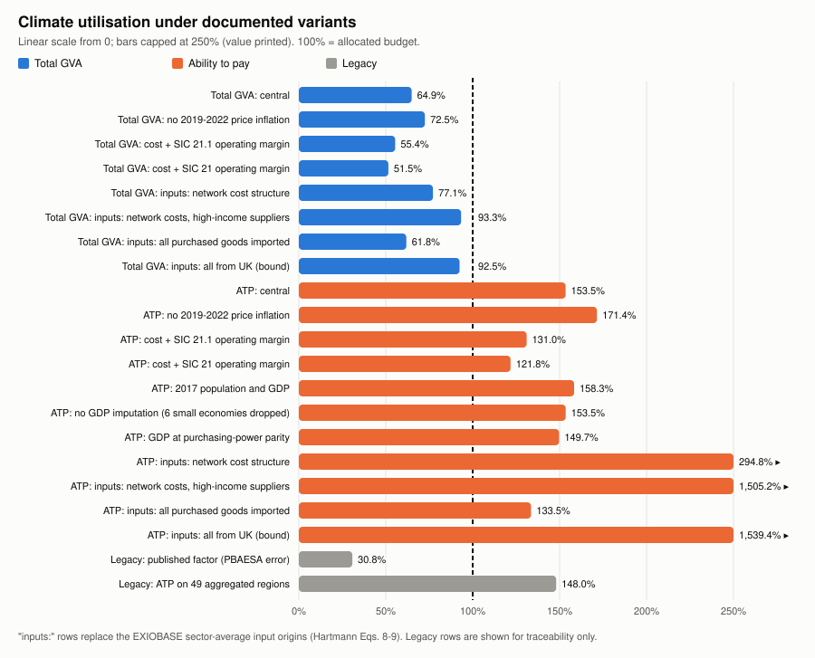

# Planetary-boundary allocation for the UK mAb network: total GVA and ability to pay

Methodology report, 19 November 2026. This report finalises the two allocation methods used in the FYR. **Total gross value added (GVA)** is the primary method (Hartmann et al. 2026). **Ability to pay** is the alternative (Hjalsted et al. 2021). **Total final consumption expenditure (FCE)** is kept as a supporting comparison. All earlier figures were re-derived from the papers, the vendored code and the raw data, and were not taken as given. Environmental impacts, the LCA and the joint MILP are **unchanged**.

| | |
|---|---|
| Implementation | [`2b_PB_Allocation/pb_allocation.py`](pb_allocation.py): single entry point, reads only committed data |
| Results | [`2b_PB_Allocation/results_allocation_final/`](results_allocation_final/): tables, MILP budgets, charts, validation, provenance |
| Data builders | [`build_ability_to_pay_weights.py`](tools/build_ability_to_pay_weights.py), [`verify_total_gva.py`](tools/verify_total_gva.py), [`extract_network_cost_structure.py`](tools/extract_network_cost_structure.py) |
| Tests | [`2b_PB_Allocation/tests/test_pb_allocation.py`](tests/test_pb_allocation.py): 34 tests pass; 23 export checks pass; independent raw-data audit in [`audit_from_raw.py`](tools/audit_from_raw.py) |

[Finalisation findings and expanded sensitivities](FINALISATION.md) update this methodology. [The separate Astra audit](audit/INDEPENDENT_AUDIT_ASTRA.md) independently checks the source calculations. Section 12 preserves Claude Code's original audit as a historical record.

## 1. Summary

| | Total GVA (primary) | Ability to pay (alternative) |
|---|---|---|
| Ethical principle | Equal per capita, then by economic value created (egalitarian + utilitarian) | Prioritarian (poorer people get more), then by economic value created |
| **Climate utilisation (central)** | **64.9%** | **153.5%** |
| Range, one assumption changed at a time | 51.5–93.3% | 106.1–1,539% |
| Range, all 24 combinations of value basis × input origin | 46.3–104.3% | 84.2–1,720% |
| Boundaries exceeded (central) | none | **climate change** |
| Robustness of that conclusion | within budget in 22 of 24 combinations | exceeded in 22 of 24 combinations |
| Change from earlier figure | 64.9%: confirmed | 148% → 153.5% (country-level calculation) |
| Most sensitive assumption | Value of output (±20%) | Origin of purchased inputs (factor of ~10) |
| Audit verdict (§12) | **Ready for exploratory fixed-budget runs** | **Usable with documented assumptions** (normative stress test) |

Main findings:
1. **The PBAESA total-GVA error is real.** It was confirmed by reading the code, by running the vendored function on a synthetic economy, and by an independent recomputation from raw EXIOBASE. The published factor for GB Chemicals nec (4.161×10⁻⁴) should be 1.973×10⁻⁴, so climate goes from 30.8% to 64.9%.
2. **Ability to pay must be calculated per country**, as Hjalsted et al. do. Doing so reproduces their α (0.234–0.239 vs 0.243). Applying it to 49 aggregated regions, as before, gave 148%; the correct value is 153.5%.
3. **The ability-to-pay result depends heavily on where inputs come from.** With EXIOBASE sector-average sourcing, 78.47% of the budget is attributed to India and three rest-of-world regions representing 2.70% of first-tier inputs. All foreign regions account for 92.58% of the budget from 25.55% of first-tier inputs. With the network's own cost structure the result is 295%, and with high-income suppliers about 1,500%. With the full supply chain used for the regional split it is 106%. Total GVA is far less sensitive (58.3–93.3%).
4. **Switching between the methods only rescales the budgets**: ability-to-pay budget = 0.4229 × total-GVA budget, identically for all nine boundaries.
5. **$92.10/g is kept** as a documented zero-margin scenario for the value of output.

## 2. Why these two methods

- **Total GVA** is the method recommended by the dataset we use (Hartmann et al. 2026). It is consistent with a cradle-to-gate inventory, because total value includes upstream value just as the footprint includes upstream impacts. It needs only published or verifiable data, and its key (value of output) can be matched exactly to our network.
- **Ability to pay** is a peer-reviewed alternative fairness principle (prioritarianism). It slots into the *same* framework by replacing only the geographical step. Comparing the two isolates the ethical choice of how the SOS is shared between countries, holding the sector and network steps constant. It is also the only established principle we examined that makes a boundary bind for this network, so it gives the optimisation formulations something to act on.
- **Total FCE** is kept as Hartmann's companion consumption perspective. Its factor may contain a second code issue, so it is reported as a range and not used to draw conclusions.
- Not carried forward: status quo/grandfathering (rewards current polluters; examined earlier), the illustrative 0.1% share (no basis), network direct-GVA keys (mismatched with total factors), and the $200/g price (unsourced).

## 3. Framework: three separate steps

Hartmann et al. (2026) build every allocation factor with the two-step approach of Hjalsted et al. (2021): first share the SOS between people by region, then between the economic activities that create value for those people. A third step downscales from the sector to our network.

| Step | Question | Total GVA | Ability to pay |
|---|---|---|---|
| 1. Geography | How is the global SOS shared between regions? | w_r = Pop_r/Pop_world (Hartmann Eq. 2) | w_r = Σ_{c∈r} (Pop_c/Pop_w)(GDPpc_w/GDPpc_c)·α (Hjalsted Eq. 5) |
| 2. Sector | How much of region r's share goes to GB Chemicals nec? | Hartmann Eqs. 1, 4, 6–9 | **identical** |
| 3. Network | How much of the sector's share goes to our network? | s = V_net/x_sector | **identical** |

```
AF_j            = Σ_r w_r · GVA^total_{j,r} / GVA_r                       Hartmann Eq. 1 with Eq. 4
GVA^total_{j,r} = α_{r,j} · m_j · GVA^direct_j                            Eqs. 6–7
m_j             = (Σ_i v_i L_ij) / v_j,   v_i = GVA_i / x_i,  L = (I − A)⁻¹  type-I GVA multiplier (Keček et al. 2022)
α_{r,j}         = share of first-tier inputs to j (intermediates + own GVA) from region r   Eqs. 8–9
s               = V_net / x_j                                             network share of sector output
budget_c        = SOS_c · AF_j · s          utilisation_c = impact_c / budget_c
```

The two methods differ **only in w_r**. Ability to pay is not multiplied on top of total GVA. It replaces the population weight inside Eq. 1, so nothing is counted twice and no factors are mixed.

## 4. Total GVA (primary)

### 4.1 Sector, country, year and data

| Item | Choice | Justification |
|---|---|---|
| Sector | EXIOBASE "Chemicals nec" (i24.d) | NACE 21 (pharmaceuticals) maps only to this product group in the public EXIOBASE concordance. It is broader than pharma. With an output-share key, sector size cancels; only "SOS per € of output" matters. |
| Country | GB | All three network sites are in the UK |
| Year / database | 2022, EXIOBASE 3.9.6 ixi | Same as the Hartmann factors; impacts are for one year of operation |
| Population weights | PBAESA 2022 (GB 0.8525%) | Hartmann's own. They sum to 1.000089, a negligible inconsistency inherited from PBAESA. |
| GVA definition | PBAESA's six components | `calculate_GVA_per_sector` |

### 4.2 The PBAESA error

In `calculate_total_GVA_per_sector` (vendor `allocation.py`, lines 707–729), `V` has shape (n,) and `x` has shape (n, 1). `np.divide(V, x)` broadcasts to an n×n matrix, and `.iloc[:, 0]` then uses **V₀/xᵢ**: the GVA of the first sector, divided by each sector's output. The resulting "multiplier", m_j = x_j Σ_i L_ij/x_i, does not depend on value added, so it cannot be the Eq. 7 GVA multiplier.

| Evidence | Result |
|---|---|
| Code reading | Shapes and indexing as above |
| Vendored function on a synthetic economy (`test_vendored_pbaesa_function_contains_the_broadcasting_error`) | Returns exactly x_j Σ L_ij/x_i. Agrees with Eq. 7 only if all sectors have equal absolute GVA. |
| Independent recomputation from raw EXIOBASE (linear solves; α from Z as PBAESA does) | Buggy formula reproduces all 6,161 published factors (max rel. error 1.1×10⁻⁴; GB Chemicals nec 2×10⁻⁸). Eq. 7 gives 1.9729321876×10⁻⁴, identical to a separate A-based route. |
| Accounting identity | (vL) = 0.99999995 for GB Chemicals nec, so total GVA = gross output (€44,744 M) |
| Size of error | Eq. 7/published = 0.474 here; median 1.76 across sectors (not a uniform scaling) |
| Sum over sectors | Eq. 7: 1.97 ≈ world output/GVA (2.01), as expected for overlapping total factors. Published: 8.86. |

**Meaning.** Because total GVA equals gross output, the corrected budget is roughly the population share of each region where the sector's value is generated, times the network's output value divided by that region's GVA. Every euro of UK output earns the same SOS. **Status: verified (code + data); author confirmation pending.**

### 4.3 Downscaling to the network and the $92.10/g proxy

Hartmann's usage notes recommend disaggregating "based on the share of the sector's economic value attributable to the assessed anthropogenic system, for example using turnover data". Under Eq. 7 the sector's total GVA is its gross output, so the matched network key is its **gross output at basic prices**, i.e. sales value excluding product taxes.

| Value basis | € M₂₀₂₂/yr | Total GVA | Ability to pay | Status |
|---|---:|---:|---:|---|
| **SuperPro full unit cost, $92.10/g × 4,003.65 kg** | **378.4** | **64.9%** | **153.5%** | **Reference.** Full average production cost used as a zero-margin bulk output valuation. Detailed filling costs include labour, cartridges and bulk bags. See [boundary reconciliation](FINALISATION.md#valuation-and-system-boundary). |
| Cost, no 2019→2022 inflation | 338.7 | 72.5% | 171.4% | Sensitivity: the UK GDP deflator (×1.117) is general, not a pharma price index |
| Cost / (1 − ONS SIC 21.1 margin, 14.6%) | 443.1 | 55.4% | 131.0% | Illustrative uplift. SIC 21.1 basic pharmaceutical products is the closest class to drug substance (2022: turnover £2,834 M, aGVA £971 M, employment £557 M). The margin includes depreciation, which SuperPro already counts. |
| Cost / (1 − SIC 21 margin, 20.6%) | 476.8 | 51.5% | 121.8% | Illustrative uplift, all pharmaceuticals |
| $200/g "price" | 821.7 | 29.9% | – | Rejected: no source |
| EXIOBASE sector profit margin | – | – | – | Unusable: the 2022 nowcast records zero compensation and zero net operating surplus for GB Chemicals nec |
| MILP private cost (£480 M/yr) | – | – | – | Rejected: depends on the decisions and includes freight that is not in the inventory |

Limitations of $92.10/g: it is one SuperPro design case (2019 prices, one 121-batch plant replicated 7.1×); it uses general rather than pharma price inflation; and it excludes profit. The price index and margin variants are discrete scenarios. Scale and realised producer value remain uncertain.

### 4.4 Consistency with the assessment boundary

- **Scope:** the inventory is cradle-to-gate for bulk drug substance. Total-value factors are the correct partner; direct factors are for gate-to-gate burdens only (Hartmann usage notes).
- **Functional unit and time:** one year of output (861 batches, 4,003.65 kg) in 2022 terms, for both budget and impact.
- **Units:** native PBAESA control-variable units, same method version for SOS and characterisation.
- **Geography:** UK production. Upstream value and impacts both occur partly abroad, which is why Hartmann's Eq. 1 credits supplying regions (see §5.4).
- **Known asymmetry:** media and buffers are in the cost (and so in the budget) but missing from the impact inventory, so utilisation is biased **downwards**. Climate would exceed the total-GVA budget if the full footprint is ≥1.54× the current subtotal.

## 5. Ability to pay (alternative)

### 5.1 The original method

Hjalsted et al. (2021, Table 2, Eq. 5): SoSOS_ind = (SOS/Pop_world) × (GDPpc_world/GDPpc_local) × α, with α chosen so that shares sum to the SOS (their Eq. S1; **α = 0.243 for 2017**). It is prioritarian, favouring the worst-off by allocating in inverse proportion to GDP per capita. It is the geographical first step of their two-step framework; The project combines those region weights with Hartmann’s producer-side GVA rule. This places responsibility on producer regions. Hjalsted’s original second step allocates by local final consumption.

### 5.2 Implementation and validation

Calculated per country, then summed into the 49 EXIOBASE regions:

- **Data:** World Bank 2022 population (SP.POP.TOTL) and GDP in current US$ at market exchange rates (NY.GDP.MKTP.CD). Taiwan, South Sudan, Yemen and Eritrea are filled from IMF WEO. Six economies without any GDP data (Cuba, DPRK, Eritrea 2022 and three territories) use their income group's median GDP per capita. 218 economies in total.
- **Mapping:** the 44 EXIOBASE countries by ISO code; all others by World Bank region (Hartmann Table 1). Afghanistan and Pakistan go to RoW Asia-Pacific, as in the classification Hartmann used.

| Check | Result | Status |
|---|---|---|
| α for 2017, market exchange rates | 0.234 (0.239 without imputation) vs **0.243** | Approximate replication (−2 to −4%). Population source, coverage and vintage differ. |
| α for 2017, PPP | 0.431, inconsistent | Consistent with market-rate GDP in Hjalsted’s supporting information |
| World Bank population shares vs PBAESA weights | GB −0.7%; worst 5.9% (Cyprus); RoW regions within 2% | Aggregate comparison. Country assignment has a separate sensitivity. |
| Closed-form tests | Shares sum to 1; equal incomes → equal per capita; poorer → more | Verified |
| Independent recomputation of 153.5% from the country rows | Identical | Verified |

2022: α = 0.221. The UK receives 0.0512% of the global SOS, which is **6.0%** of its equal-per-capita share.

### 5.3 Was 148% correct?

Arithmetically yes, but it applied Eq. 5 to the 49 regions, using EXIOBASE GVA as GDP. Averaging incomes within the Rest-of-World regions gives rich countries too much, because the weight is convex in income: the UK received 0.074% instead of 0.051%. The country-level central value is **153.5%**. The difference is small only because the UK term is a small part of the ability-to-pay budget (next section).

### 5.4 Reliance on imported inputs and whether sector-average sourcing fits the network

Hartmann's Eq. 1 credits each region with the value it generates in the sector's first-tier inputs (α_r). Under ability to pay, one euro of value in a poor region earns far more SOS than one in the UK: 414× for India and 1,226× for RoW Africa, against 20× and 28× under equal per capita. With EXIOBASE sector-average sourcing for GB Chemicals nec:

| Region | Share of sector inputs | Share of total-GVA budget | Share of ability-to-pay budget |
|---|---:|---:|---:|
| GB | 74.5% | 52% | **7%** |
| India | 0.63% | 9% | **26%** |
| RoW Asia-Pacific | 0.78% | 6% | **21%** |
| RoW Middle East | 1.17% | 5% | **17%** |
| RoW Africa | 0.12% | 2% | **15%** |

India and the three listed rest-of-world regions account for 78.47% of the budget from 2.70% of first-tier inputs. All foreign regions account for 92.58% of the budget from 25.55% of inputs. **Is the sector average appropriate for our network?** Two features suggest it is not:

1. **Cost structure.** In EXIOBASE, the sector's own value added is 36% of inputs, UK intermediates 38% and imports 26%. Our network (SuperPro entire-process costs) is 70.2% facility, labour, QC, utilities and waste, all UK first-tier. Only 29.8% is purchased raw materials and consumables.
2. **Supplier mix.** The sector's import mix reflects bulk and generic chemicals (e.g. Indian APIs, Middle-East petrochemicals). Single-use systems, chromatography resins, filters and cell-culture media come mainly from manufacturers in high-income economies. This is a qualitative judgement; it is not quantified with supplier data here.

Scenarios (`input_origin` in `pb_allocation`), one assumption changed at a time:

| Input origin | Foreign share of inputs | Total GVA | Ability to pay | UK share of ATP budget |
|---|---:|---:|---:|---:|
| **Sector average (Hartmann default; central)** | 25.5% | **64.9%** | **153.5%** | 7% |
| Network cost structure; purchased goods imported at the sector's import ratio (40%) and mix | 11.9% | 77.1% | 294.8% | 17% |
| As above, imports only from high-income regions | 11.9% | 93.3% | 1,505% | 86% |
| Network cost structure; all purchased goods imported, sector mix | 29.8% | 61.8% | 133.5% | 6% |
| All inputs from UK (bound) | 0% | 92.5% | 1,539% | 100% |
| Full-supply-chain regional split of value added (audit, §12) | 31.6% | 58.3% | 106.1% | – |

**Interpretation.** The sector-average default is kept as the central case for both methods. It is the published construction, it makes the two methods comparable, and the alternatives depend on an assumed import ratio. The cost-structure and high-income scenarios illustrate how assumed procurement can tighten ATP. Actual manufacturing origins are unknown. With the network's own cost structure it roughly doubles (295%; ocean acidification then reaches 94%), and with high-income suppliers it is about 15× the budget. The opposite adjustment also exists. Hartmann's Eqs. 8–9 regionalise *whole-chain* value using *first-tier* inputs only; tracing all embodied value added to its origin lowers ability to pay to 106%. Total GVA stays within budget whenever one assumption is changed (58.3–93.3%). Ethically, under the sector average, a prioritarian principle ends up granting a UK producer most of its budget from poorer people's shares. This follows consistently from Hartmann's framework, but the FYR should state it.

**Status.** The reference arithmetic reproduces. Expanded discrete combinations cross 100% for both methods. See [final sensitivities](FINALISATION.md#sensitivity).

## 6. Results for all supported boundaries

Saved two-stage network, 2022, SuperPro cost valuation, sector-average input origins. † = budget exceeded. Impacts are an **incomplete characterised subtotal** ([`utilisation_summary.csv`](results_allocation_final/utilisation_summary.csv)).

| PB indicator | Unit | Annual impact | Budget, total GVA | **Total GVA %** | Budget, ability to pay | **Ability to pay %** | Total FCE % |
|---|---|---:|---:|---:|---:|---:|---:|
| Climate change | W/m² | 1.083e-06 | 1.668e-06 | **64.9** | 7.056e-07 | **153.5†** | 15.0–23.2 |
| Ocean acidification | Ωarag | 2.373e-07 | 1.148e-06 | 20.7 | 4.854e-07 | 48.9 | 4.8–7.4 |
| Aerosol loading | AOD | 3.023e-08 | 1.835e-07 | 16.5 | 7.761e-08 | 38.9 | 3.8–5.9 |
| Phosphorus cycle | Tg P/yr | 1.850e-06 | 1.668e-05 | 11.1 | 7.056e-06 | 26.2 | 2.6–4.0 |
| Biosphere integrity | BII % | 1.301e-06 | 1.668e-05 | 7.80 | 7.056e-06 | 18.4 | 1.8–2.8 |
| Freshwater use | km³/yr | 1.381e-04 | 6.674e-03 | 2.07 | 2.822e-03 | 4.89 | 0.48–0.74 |
| Ozone depletion | DU | 4.584e-08 | 2.419e-05 | 0.190 | 1.023e-05 | 0.448 | 0.04–0.07 |
| Nitrogen cycle | Tg N/yr | 1.220e-07 | 1.034e-04 | 0.118 | 4.375e-05 | 0.279 | 0.03–0.04 |
| Land-system change | Mkm² | 1.519e-07 | 1.420e-04 | 0.107 | 6.005e-05 | 0.253 | 0.02–0.04 |




The 15.0–23.2% Total FCE values are unresolved historical variants. The separate Astra audit explains why neither variant resolves the source-equation discrepancy. Ability to pay × total FCE gives 20.5%. Full sensitivity table: [`sensitivity_climate.csv`](results_allocation_final/sensitivity_climate.csv); regional decomposition: [`regional_contributions.csv`](results_allocation_final/regional_contributions.csv).

## 7. Verified, assumed and uncertain

| Item | Class | Basis |
|---|---|---|
| PBAESA tGVA broadcasting error; Eq. 7 factor 1.973×10⁻⁴ | **Verified** | Code, synthetic test, two independent numerical routes |
| Total GVA = gross output for GB Chemicals nec | **Verified** | (vL) = 0.99999995 |
| Country-level ATP weights, market-rate GDP | **Verified** | Reproduces Hjalsted α within 2–4%; PPP rejected |
| Annual mass 4,003.65 kg; currency path 1.026185 €₂₀₂₂/$₂₀₁₉ | **Verified** | MILP output; BoE, ONS, ECB sources |
| 64.9%, 153.5%, 15.0%, 21.5%, 23.2% (central) | **Verified** | Recomputed from raw sources by `audit_from_raw.py` (agreement 3×10⁻¹⁵) |
| Sector concordance (NACE 21 → Chemicals nec) | Assumption (standard) | Public concordance; broader than pharma |
| Output valued at SuperPro cost | Assumption (conservative) | Lower bound; variants 51.5–72.5% (GVA) |
| Sector-average first-tier input origins (α) | Assumption (Hartmann default) | ATP 106–1,539% across origins (§5.4) |
| Assumptions combine multiplicatively | Limitation | Combined cases cross 100% for both methods ([expanded scenarios](FINALISATION.md#sensitivity)) |
| Total FCE published vs corrected | **Unresolved issue** | Published factor very probably wrong; correct formula unconfirmed; 15.0–23.2% |
| Completeness of the impact inventory | Uncertain | Missing media/buffers, cold chain, fabrication; 1.54× threshold |
| Author confirmation of the corrections | Outstanding | To be requested |

## 8. Using the budgets in the joint MILP

**Selection.** `pb_allocation.budget_vector("total_gva")` or `budget_vector("ability_to_pay")` returns {indicator: annual budget} in native units. The same numbers, plus a `sensitivity_sos_fractions` block (value basis × input origin), are in [`milp_budgets.json`](results_allocation_final/milp_budgets.json). Use them as **fixed parameters**, chosen once per run and never by the solver. Production is fixed (861 batches), so budgets do not depend on decisions. If a later model lets output vary, keep the budget at the demand level.

**Rescaling or reweighting?** Both methods give B_c = f·SOS_c, with f_GVA = 1.668×10⁻⁶ and f_ATP = 7.056×10⁻⁷. The ratio is 0.4229 for all nine indicators. The same holds for every sensitivity variant, which also only changes f. Switching method therefore **rescales** the budgets and never changes their relative importance.

| Formulation (to be implemented later) | Consequence of choosing ability to pay instead of total GVA |
|---|---|
| ε-constraint: min cost s.t. I_c ≤ ε·B_c | Identical feasible sets with ε relabelled (ε_ATP = 1 ⇔ ε_GVA = 0.423). One sweep on SOS-normalised impacts serves both; draw both 100% lines on one cost–utilisation curve. Meeting the ATP budget needs a climate cut of ≥35% from the saved design. |
| Minimax: min max_c I_c/B_c | Same optimal design; z* scaled by 2.365. Climate (about 3× the next indicator) drives the solution. |
| Ehrenstein transgression: min Σ max(0, I_c/B_c − 1) | Total GVA: zero at the saved design, so the objective is degenerate. ATP: only climate is positive (0.535), so it reduces to "bring climate down to its budget", then goes flat. Ocean acidification would join if the footprint grows 2.05×, or under the network-cost input origin (94%). |

Implementation notes: scale each PB row by its budget (r_c = I_c/B_c), because native budgets are about 10⁻⁶. Keep fixed impact terms inside the constraints. Report both methods side by side.

**Readiness.** Total GVA supports exploratory fixed-budget optimisation. Producer-region ATP supports a separate ethical scenario. The characterised subtotal, real output value and actual sourcing limit any absolute sustainability claim. The budget export contains these two decision methods.

## 9. Relation to other project files

- Earlier allocation reports in Ahmed's project (`09_Documentation/02_Analysis_Reports/`: *PB allocation methodology review*, *PB alternative allocation principles*, *PB allocation decision before MILP*) are superseded on allocation where they differ. This file is the copy of *PB allocation methods final*.
- Alfie's `2a_PB-LCA /FYR_Economic_Allocation.xlsx` (GitHub, 17 November) reproduces the 14 November review: published total-GVA factor, $200/g and network-GVA shares. Those inputs are superseded by this report (factor error; unsourced price; mismatched key). The workbook was not modified.

## 10. Limitations and unresolved uncertainties

1. The impact inventory is incomplete; every "within budget" statement applies to the characterised subtotal only.
2. Neither PBAESA correction (total GVA; possible total FCE issue) has been confirmed by the authors.
3. Ability to pay depends on the origin of purchased inputs and on how whole-chain value is regionalised (§5.4, §12.3). Neither is known for a hypothetical network.
4. Chemicals nec is broader than biopharmaceuticals; the EXIOBASE 2022 nowcast has value-added anomalies for this sector (zero compensation recorded).
5. The cost basis is one SuperPro design case at 2019 prices, replicated linearly.
6. The nine PBAESA indicators do not cover novel entities or regional boundaries, and the climate and biosphere control variables are those of the PBAESA method.
7. The local EXIOBASE `Z.txt` has one corrupted cell (value 2.39×10⁻¹³). It is detected and bypassed by the verification tool; the file was not edited.
8. Sensitivities compound: combined envelopes (§12.5) are wider than the one-at-a-time ranges.
9. Total-value factors overlap along supply chains (Eq. 7 factors sum to 1.97 over all sectors), so every actor being "within budget" would not by itself guarantee global compliance. This is inherent to Hartmann's total factors and matched by the overlapping footprints.
10. PB-LCIA characterisation converts annual emissions to control-variable changes under the PBAESA convention. Budgets and impacts share that convention, so the ratios are consistent; they should not be compared with observed global boundary status.

## 11. Reproduce

From the repository root, without EXIOBASE:

```bash
.venv/bin/python -B 2b_PB_Allocation/tools/finalise_allocation.py
```

```bash
.venv/bin/python -B -m unittest discover -s 2b_PB_Allocation/tests -v
```

Rebuild the committed inputs (optional):

```bash
.venv/bin/python -B 2b_PB_Allocation/tools/build_ability_to_pay_weights.py
```

```bash
.venv/bin/python -B 2b_PB_Allocation/tools/extract_network_cost_structure.py
```

```bash
.venv/bin/python -B 2b_PB_Allocation/tools/verify_total_gva.py --exiobase <EXIOBASE IOT_2022_ixi folder>
```

```bash
.venv/bin/python -B 2b_PB_Allocation/tools/audit_from_raw.py --exiobase <EXIOBASE IOT_2022_ixi folder>
```

## 12. Claude Code audit (19 November 2026, historical)

This section records the audit as delivered on the source branch. The [finalisation note](FINALISATION.md) supersedes its claims about valuation bounds, filling, sensitivity coverage and integration readiness.


The audit re-examined the papers, the PBAESA code, the raw data and the results. The new tool `tools/audit_from_raw.py` rebuilds every result from raw EXIOBASE, the Hartmann workbook, PBAESA source literals, raw World Bank/IMF files, the SuperPro report, the MILP mass and the saved impacts. It does not use `pb_allocation` or any committed extract. Earlier results are preserved in `results_allocation_final/pre_audit_20261119/`.

### 12.1 Central results: verified

| Result (climate) | Module | Raw recomputation |
|---|---:|---:|
| Total GVA, Eq. 7 | 64.8987% | 64.8987% |
| Ability to pay × total GVA | 153.4593% | 153.4593% |
| Total FCE, published formula | 15.0050% | 15.0050% |
| Total FCE, FR-orientation corrected | 21.5089% | 21.5089% |
| Total GVA, PBAESA formula (reproduces the published factor to 5×10⁻¹⁴) | 30.7686% | 30.7686% |

Maximum relative deviation over all nine indicators: 3×10⁻¹⁵. The SOS values match the PBAESA code and the CF workbook. The impact file is unchanged (hash-checked). Units, functional unit (one year, 4,003.65 kg bulk drug substance), year (2022) and geography are consistent between budgets and impacts. Replacing the PBAESA population weights with World Bank 2022 populations changes total GVA by 0.3%.

### 12.2 PBAESA total-GVA correction: justified

The code's multiplier x_j Σ_i L_ij/x_i contains no value-added coefficient. It therefore cannot be the "type-I gross-value-added multiplier" that Eq. 7 specifies (Keček et al.: (Σ_i v_i L_ij)/v_j). The published factors equal the code's formula to 5×10⁻¹⁴ and differ from Eq. 7 by a sector-specific amount. Correcting to Eq. 7 implements the paper as written; it is not a new modelling choice. **No change needed.** Author confirmation is still advisable before publication.

### 12.3 Ability to pay: calculation verified; conclusion assumption-dependent

The country-level weights reproduce Hjalsted's α and use market-rate GDP. That is correct. The audit adds two challenges:
1. **Regionalisation.** Hartmann's Eqs. 8–9 split *whole-chain* total GVA by *first-tier* input shares. Using the full-supply-chain origin of embodied value added instead (GB 68.4%) gives **106.1%**. Still exceeded, but barely.
2. **Perspective.** Hjalsted's own upscaling step is consumption-based (customers' FCE). Paired with total FCE, ability to pay gives **20.5%**. "Climate exceeded under ability to pay" is therefore a result of the **production (GVA) perspective** chosen for the FYR, and the paper should say so.

### 12.4 Total FCE discrepancy: not resolvable with available sources

The published factor is reproduced exactly by PBAESA's code (3×10⁻¹⁵). That code weights each supplying sector by its *own* final demand: `S_marginal * FR_vector` with an (n, 1) vector broadcasts along rows. Three pieces of evidence indicate this is wrong. The code comment says the share is based on the final demand of sector *i* (the column). The paper says total FCE captures downstream value induced by the sector's output. And Oosterhoff et al. (2023) designed the framework for business-to-business sectors, yet 146 sectors with output and no direct final demand receive zero. Correcting the orientation gives 21.5%. Also indexing Oosterhoff's scaling f by the final product gives **23.2%**. The paper's equations were not accessible (paywalled), so the correct variant cannot be confirmed. **Classification: unresolved methodological issue.** Report 15.0–23.2% as a supporting range only.

### 12.5 Assumptions compound: robustness statements corrected

Budgets are products of independent factors, so the one-at-a-time ranges understated the spread. All 24 combinations of value basis × input origin (`envelope_climate.csv`):

| Method | Min | Max | Combinations exceeding 100% |
|---|---:|---:|---:|
| Total GVA | 46.3% (cost + SIC 21 margin, full-chain split) | 104.3% (no price inflation, high-income suppliers) | 2 of 24 |
| Ability to pay | 84.2% (cost + SIC 21 margin, full-chain split) | 1,720% (no price inflation, UK-only inputs) | 22 of 24 |

**Correction to earlier text:** "within budget in every variant" (total GVA) and "exceeded in every variant" (ability to pay) held only one assumption at a time. The statements in §1 and §5.4 were revised. No central value changes.

### 12.6 Value proxy ($92.10/g)

The proxy is confirmed: it is a full production cost (materials 7%, consumables 23%, facility incl. depreciation 53%, labour 12%, QC 3%, utilities 2%), excludes profit, and covers the same bulk drug substance as the inventory. Valued against EXIOBASE gross output at basic prices it is a lower bound, so the budget is conservative. Its limitations (one design case, 2019 prices, linear replication, GDP deflator) are genuine but covered by the sensitivities. **No change needed.**

### 12.7 Audit verdict

| Method | Verdict | Reason |
|---|---|---|
| **Total GVA** | **Validated and ready for MILP integration** | Correction mathematically justified; every number reproduced from raw data; within budget in 22 of 24 combined cases; only caveats are author confirmation and inventory completeness. |
| **Ability to pay** | **Usable with documented assumptions** | Calculation validated against Hjalsted; ready as a normative stress-test budget. Its conclusion depends on the production perspective, on input origins and on regionalisation (84–1,720%); not a basis for firm claims about magnitude. |
| **Total FCE** | **Not ready (as an MILP budget)**; supporting range only | Published factor very probably affected by a code error; corrected formula unconfirmed (15.0–23.2%). |

### 12.8 Changes made in the audit

| File | Change |
|---|---|
| `tools/audit_from_raw.py` (new) | Independent raw-data recomputation; writes `data/audit_from_raw_2022.json` and `data/exiobase_audit_terms_2022.json` |
| `pb_allocation.py` | `input_origin="full_supply_chain"`; method `total_fce_corrected_f`; `envelope()` helper. Defaults and central results unchanged. |
| `tools/finalise_allocation.py` | Full-chain and third-FCE rows; `envelope_climate.csv`; raw-audit agreement and SOS checks (23 checks); provenance skips subfolders |
| `tests/test_pb_allocation.py` | 5 new tests (34 in total): raw-audit agreement, published-factor reproduction, SOS, full-chain shares, combined envelope |
| `results_allocation_final/` | Regenerated; pre-audit outputs kept in `pre_audit_20261119/` |
| This report | Robustness statements, total FCE range (15.0–23.2%), limitations 8–10 and this section |

## References

**Methods**
- Hartmann, J.M., Shu, D.Y., Bardow, A. & von der Assen, N. (2026). Allocation and characterisation factors for absolute environmental sustainability assessment. *Scientific Data* 13, 970. [doi:10.1038/s41597-026-07797-w](https://doi.org/10.1038/s41597-026-07797-w). Eqs. 1–9, Table 1, usage notes. Code: PBAESA commit d932921 (MIT); allocation-factor dataset (CC BY-NC-SA, custom).
- Hjalsted, A.W., Laurent, A., Andersen, M.M., Olsen, K.H., Ryberg, M. & Hauschild, M. (2021). Sharing the safe operating space: exploring ethical allocation principles to operationalize the planetary boundaries and assess absolute sustainability at individual and industrial sector levels. *J. Ind. Ecol.* 25, 6–19. Table 2, Eq. 5; α = 0.243 (2017). [DTU author copy](https://backend.orbit.dtu.dk/ws/files/234548766/Hjalsted_2020_.pdf)
- Keček, D., Brlek, P. & Buntak, K. (2022). Economic effects of transport sectors on Croatian economy: an input–output approach. *Econ. Res.-Ekon. Istraživanja* 35, 2023–2038 (type-I GVA multiplier; Hartmann ref. 20).
- Oosterhoff, H.C., Golsteijn, L., Laurent, A. & Ryberg, M.W. (2023). A new consistent framework for assignment of safe operating space to B2C and B2B industries. *J. Clean. Prod.* 399, 136574.
- Ehrenstein, M. et al. (2020). Optimising fuel supply chains within planetary boundaries. *Appl. Energy* 276, 115486.
- Mavrotas, G. (2009). Effective implementation of the ε-constraint method. *Appl. Math. Comput.* 213, 455–465.

**Economic data**
- Stadler, K. et al. (2018). EXIOBASE 3. *J. Ind. Ecol.* 22, 502–515; data version 3.9.6, 2022 ixi (CC BY-SA 4.0).
- World Bank, World Development Indicators: SP.POP.TOTL, NY.GDP.MKTP.CD, NY.GDP.MKTP.PP.CD; country metadata (retrieved 19 Nov 2026; CC BY 4.0).
- IMF, World Economic Outlook DataMapper: NGDPD, LP (retrieved 19 Nov 2026; gap filling only).
- ONS, Annual Business Survey, sections A–S (SIC 21, 21.1; 2022), retrieved 11 Nov 2026 (Open Government Licence).
- Bank of England XUAAUSS (USD/GBP 2019); ONS YBGB GDP deflator; ECB euro reference rate GBP/EUR 2022.
- SuperPro Designer report `mab_fedbatch_1000_sut_ICR.xls`, "SUMMARY PER COST ITEM (Entire Process)" (project model output).
