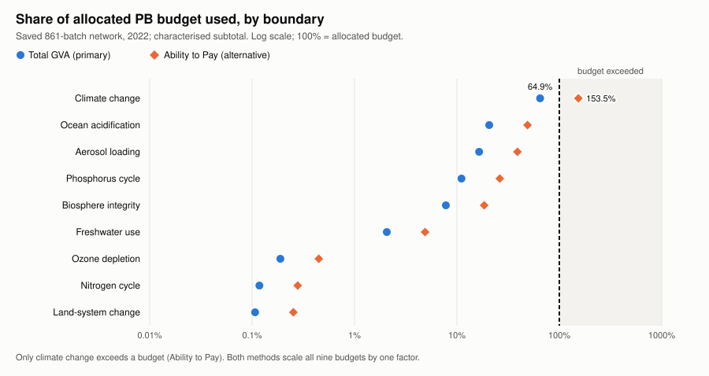

# 2b. Planetary-boundary budgets: Total GVA and Ability to Pay

This folder turns the global planetary-boundary (PB) safe operating space into **annual budgets for our UK mAb network** (861 batches, 4,003.65 kg/yr of bulk drug substance) and compares them with the network's impacts.

| Method | Role | Idea | Climate budget used |
|---|---|---|---:|
| **Total GVA** | Primary | Every person gets an equal share; each region's share goes to activities by the value they create (Hartmann et al. 2026) | **64.9%**, within budget |
| **Ability to Pay** | Alternative | Poorer countries get more, richer countries less (Hjalsted et al. 2021); then as above | **153.5%**, **exceeded** |

No other boundary is exceeded under either method (ocean acidification is next: 20.7% / 48.9%).



## Results

| File | Contents |
|---|---|
| [`final_results/budgets.csv`](final_results/budgets.csv) | Budget, impact and % used for all nine boundaries, both methods |
| [`final_results/milp_budgets.json`](final_results/milp_budgets.json) | Budget vectors for the joint MILP |
| [`final_results/FYR_PB_budgets.xlsx`](final_results/FYR_PB_budgets.xlsx) | Same budgets as a workbook (also copied to `2a_PB-LCA/FYR_Economic_Allocation.xlsx` for the economic-only joint model) |
| [`final_results/sensitivity_climate.csv`](final_results/sensitivity_climate.csv), [`climate_sensitivity.svg`](final_results/climate_sensitivity.svg) | Climate result with one assumption changed at a time |
| [`final_results/climate_ranges.csv`](final_results/climate_ranges.csv) | Extremes with all assumptions combined: Total GVA 39.5–108.2%, Ability to Pay 70.4–1,773% |
| [`final_results/regional_contributions.csv`](final_results/regional_contributions.csv) | Which regions each budget comes from |
| [`final_results/validation.json`](final_results/validation.json) | Built-in checks (all pass) |

**How to read them.** Total GVA is within budget in 93% of all combined scenarios; Ability to Pay exceeds it in 91%. The impacts are an incomplete subtotal, so "within budget" is conditional. Full explanation, equations and limitations: **[METHODOLOGY.md](METHODOLOGY.md)**.

## Use in the joint MILP

```python
import sys; sys.path.insert(0, "2b_PB_Allocation")
import pb_allocation as pa

B = pa.budget_vector("total_gva")      # or "ability_to_pay"
# {"Climate Change": 1.668e-06, ...}   annual budgets, native PB units
```

- Budgets are **fixed parameters**: pick one method per run, never let the solver choose.
- Ability to Pay = 0.4229 × Total GVA for **every** boundary, so switching method only rescales the budgets.
- Write each PB row as impact / budget ≤ 1 (budgets are ~10⁻⁶ in native units).

## Reproduce

From the repository root (needs only `numpy`, `pandas`, `openpyxl`):

```bash
python -B 2b_PB_Allocation/tools/finalise.py
```

```bash
python -B -m unittest discover -s 2b_PB_Allocation/tests -v
```

Expected: "10 checks passed" and 19 passing tests.

## Folder contents

| Path | What it is |
|---|---|
| `pb_allocation.py` | All calculations (about 200 lines) |
| `tools/finalise.py` | Writes `final_results/` |
| `tools/build_ability_to_pay_weights.py` | Rebuilds the country weights from `data/worldbank/` |
| `tools/extract_exiobase.py` | Rebuilds `data/exiobase_gb_chemicals_2022.json` from raw EXIOBASE (optional, ~1.3 GB input) |
| `tests/` | 19 tests |
| `data/` | EXIOBASE sector terms, country weights, economic inputs (with sources), reference impacts, World Bank/IMF downloads |
| `vendor/pbaesa/` | Original PBAESA `allocation.py` (MIT), used by the tests to demonstrate the code error |
